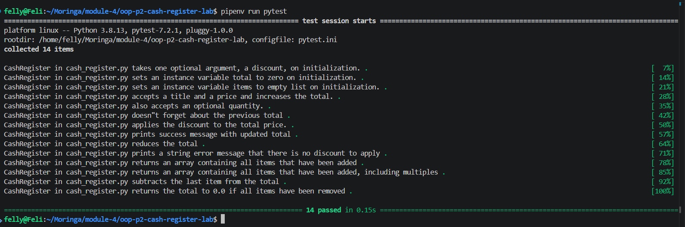

# Cash Register - Object-Oriented Programming Part 2

## Project Overview

This project implements a `CashRegister` class in Python to simulate basic cash register operations for an e-commerce application. It demonstrates object-oriented programming concepts, including classes, instance attributes, properties, and methods.

## Features

- **Initialize a cash register:** Set a discount percentage, with a default of 0%.
- **Validate discounts:** Accept integer discount values between 0 and 100 inclusive.
- **Add items:** Add products, prices, and quantities while updating the total.
- **Apply discounts:** Calculate the discounted total and display the updated price.
- **Track items:** Maintain a list of purchased items, including multiple quantities.
- **Void transactions:** Remove the most recent transaction and reverse its effect on the total.
- **Automated testing:** Use pytest to verify the cash register functionality.

## Technologies Used

- Python 3
- pytest
- Pipenv
- Git and GitHub

## Project Structure

```text
oop-p2-cash-register-lab/
├── lib/
│   ├── cash_register.py
│   └── testing/
│       ├── conftest.py
│       └── cash_register_test.py
├── .gitignore
├── Pipfile
├── Pipfile.lock
├── pytest.ini
└── README.md
```

## Installation and Setup

1. Clone the repository:

   ```bash
   git clone https://github.com/felixouma10/oop-p2-cash-register-lab.git
   ```

2. Navigate into the project directory:

   ```bash
   cd oop-p2-cash-register-lab
   ```

3. Install the project dependencies:

   ```bash
   pipenv install --dev
   ```

## Running the Tests

Run the automated tests using:

```bash
pipenv run pytest
```

To run the tests with an explicit Python module path if needed:

```bash
pipenv run env PYTHONPATH=lib pytest
```

## Screenshot



## Learning Outcomes

This project demonstrates the ability to:

- Design and implement a Python class.
- Initialize and manage instance attributes.
- Use properties and setters to validate data.
- Implement methods that modify object state.
- Track and reverse transactions.
- Write and run automated tests with pytest.
- Document a Python project using Markdown.

## Test Results

The supplied automated test suite passed all **14 tests** during development.

## Author

Felix Ouma